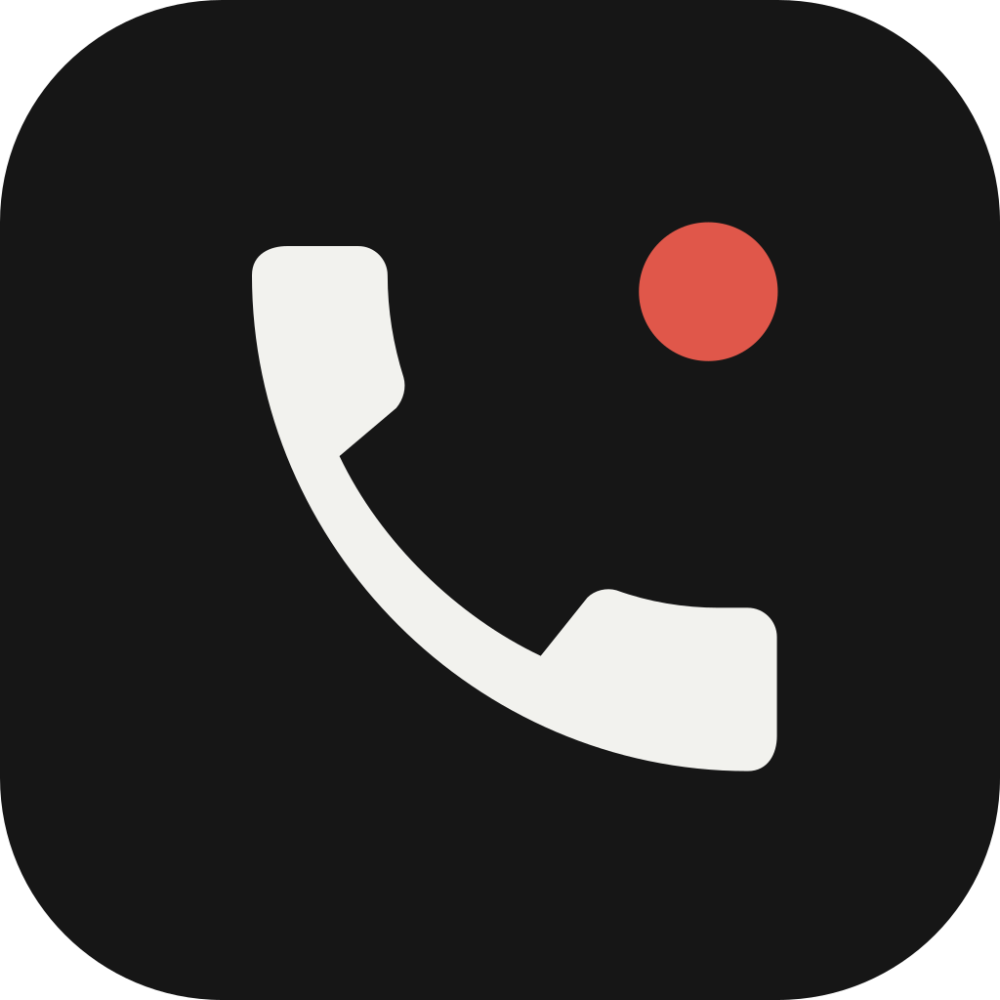

<p align="center">
  
</p>

<h1 align="center">Acta</h1>
<p align="center"><strong>Tu app de teléfono con memoria.</strong><br>
Graba las dos voces de cada llamada, y al colgar te deja un resumen y las tareas pendientes.<br>
Gratis, sin cuentas, sin anuncios y de código abierto.</p>

<p align="center">
  <a href="https://github.com/actaapp-es/acta/releases/latest/download/Acta.apk"></a>
  <a href="https://github.com/actaapp-es/acta/releases/latest/download/ActaConexion-Windows.zip"></a>
</p>
<p align="center">
  <a href="https://github.com/actaapp-es/acta/actions/workflows/build.yml"></a>
  <a href="LICENSE"></a>
  
  
</p>

---

## Qué es

Acta es una aplicación de teléfono para Android (marcador, llamadas, historial y grabadora) pensada para quien necesita **recordar lo que se dijo en una llamada**. Todo vive en tu móvil: no hay servidor, ni cuentas, ni publicidad, ni analítica.

| | |
|---|---|
| 🎙️ **Las dos voces** | Graba a ambos interlocutores sin poner el altavoz, mediante un cliente ADB propio integrado en la app. |
| ✨ **Resumen y tareas al colgar** | Contexto, resumen breve y lo acordado, con acceso directo al calendario. IA **opcional**, con tu propia clave de Groq. |
| 🔎 **Pregunta a Acta** | «¿Qué precio me dijo?» → respuesta con el minuto exacto de la grabación. |
| 🔒 **Privada por diseño** | Grabaciones cifradas (AES-256-GCM, Android Keystore), bloqueo biométrico, nada sale del móvil sin tu permiso. |
| 👤 **Contexto al recibir llamadas** | «Hace 3 días: quedó en enviarte el presupuesto». Ficha de cada persona con su historial. |
| ⏰ **Llamadas programadas, doble SIM, widgets, spam, modo oscuro** | Y borrado automático de audios (conservando los resúmenes) y favoritos. |

> **Importante:** grabar una llamada puede requerir el consentimiento de la otra persona según tu país. Acta no avisa a quien llama; tú eres responsable de cumplir la ley. Lee el [aviso legal](docs/AVISO-LEGAL.md).

## Instalación (usuarios)

1. Descarga **`Acta.apk`** de la [última versión](https://github.com/actaapp-es/acta/releases/latest) e instálala (Android te pedirá permitir instalar desde tu navegador).
2. Abre Acta, ponla como **app de teléfono** y concede los permisos.
3. Pulsa **Empezar** en el aviso «Graba las dos voces». El tutorial te guía y detecta solo lo que ya has hecho. En Windows se apoya en **Acta Conexión** (descárgalo en la misma página): hace los pasos técnicos por ti y vuelve a activarlo cada vez que reinicies el móvil.

Comprueba que lo descargado es auténtico con `SHA256SUMS.txt`, que acompaña a cada versión. Guía completa con capturas: [docs/INSTALAR.md](docs/INSTALAR.md).

## Cómo funciona

Android no permite a una app normal capturar el audio de la línea. Acta usa el modo de **depuración inalámbrica local** del propio móvil:

```
 Móvil                                                        Ordenador (una vez, o tras reiniciar)
┌────────────────────────────────────────────┐              ┌──────────────────────────┐
│  Acta (app)                                │   USB        │  Acta Conexión           │
│   ├─ cliente ADB propio ──► adbd :5555 ◄───┼──────────────┤  (adb tcpip 5555)        │
│   │        │ lanza, como usuario «shell»   │              └──────────────────────────┘
│   │        ▼                               │
│   │   AdbRecorderMain (AudioRecord VOICE_CALL) ──► WAV cifrado en el móvil
│   └─ resumen/tareas (IA opcional, tu clave)│
└────────────────────────────────────────────┘
```

Detalles técnicos en [docs/ARQUITECTURA.md](docs/ARQUITECTURA.md).

## Compilar

```bash
# Requisitos: JDK 17 y el SDK de Android (plataforma + build-tools). Sin Gradle ni dependencias externas.
export ANDROID_HOME=/ruta/al/sdk
scripts/build-android.sh        # → build/Acta-<versión>.apk
```

Guía completa (incluida la firma de publicación y las Actions): [docs/COMPILAR.md](docs/COMPILAR.md) y [docs/PUBLICAR.md](docs/PUBLICAR.md).

## Estructura

```
app/          App Android (Java, sin Gradle): código, recursos y manifiesto
third_party/  Bibliotecas incluidas (ADB, Shizuku API…) con sus licencias
pc/           Acta Conexión para Windows (Go, sin dependencias externas)
scripts/      Compilación, claves y utilidades
docs/         Documentación
.github/      Actions: compilar y publicar versiones
```

## Privacidad

- Sin cuentas, sin servidores propios, sin anuncios ni analítica.
- Las grabaciones, transcripciones, resúmenes y contactos se guardan solo en tu teléfono.
- La IA es opcional: si la activas, se envía a Groq el audio de la llamada analizada, **nunca tu número de teléfono**, y solo tras aceptar un aviso. Lee la [política de privacidad](PRIVACY.md).

## Contribuir

¡Las ayudas son bienvenidas! Lee [CONTRIBUTING.md](CONTRIBUTING.md). Para dudas de uso, el [canal de Telegram](https://t.me/actaapp). Para fallos de seguridad, [SECURITY.md](SECURITY.md).

## Licencia

[GPL-3.0-or-later](LICENSE). Incluye componentes de terceros con sus propias licencias: [THIRD_PARTY_NOTICES.md](THIRD_PARTY_NOTICES.md).
